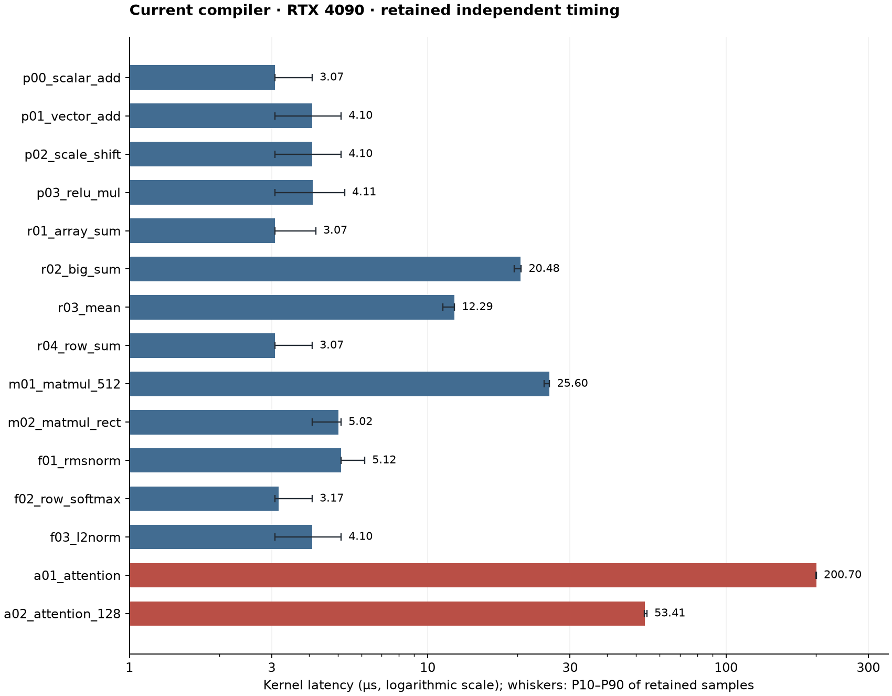

# Current compiler performance audit — 23 October 2026

The strongest identified inefficiency is repeated attention score computation:
both supplied attention schedules repeat unique Q·K products32 times across output
columns. This is established by typed IR accounting and the emitted scalar PTX,
not by a profiler. Its recoverable latency remains unmeasured. a01 additionally
has only4 blocks. The larger scalar reductions have only1 block. These schedule
limits explain why whole-GPU MFU and effective bandwidth alone are misleading.

This is an offline audit of qualified retained measurements, not a fresh GPU run.
Remote SSH hostname resolution failed from this side chat. Live gate revocation,
jobs, counters and remote persistence could not be checked. No compiler, evaluator,
launch, tolerance, research state or other chat's workers were modified. Reports
are saved locally pending transfer to the configured durable store.

## Identity and measurement validity

The local compiler SHA256 is
`ef5e7fe0092f95c86a4effa628c533c6c3ec2e4d16802035ed31073e27d88d6a`.
Recomputing the retained source manifest's canonical hash gives source
`d883119296f923cc179e64220d8fc3937930ec1cafe15a8e14e2693325f04aed`.
All15 locally regenerated PTX files match their hashes in the independent timing
receipt. Published metadata and expected-output bytes match the receipt bindings.

Suite: `0fa85c2e98ef65616058b558c1008d80f0f3530ae13cfdf276774050f8a2d5ce`.
Retained all15 gate: `0e0b699bde2a799b941b2274a39ea69e6b50812bbf32a7effadf4e3551c6591e`.
Independent timing evidence:
`e951e625fb9451da81fa1dfdfe144836887c4b23844066a12a0d62a38f95b5d7`.
The retained47 isolated cases passed guards/input integrity and required sanitizer
checks. Their comparison has32 paired samples per case plus16 A/A noise pairs.
The earlier combined correctness record covers894 cases; it was not rerun here.
Local copies establish recorded qualification, not the absence of a later remote
revocation. Manifest and report hashes are retained in manifest.json.

Times are warm reused allocations on the recorded RTX4090, using exclusive
paired GPU event intervals around kernels. They exclude CPU compile/assembly,
startup, copies, atomic resets, readback/checks and sanitizer costs. Every published
problem here has one kernel, so its ordered kernel-interval sum equals that
kernel interval. Host/API and true end-to-end times are unavailable. All47
baseline comparisons were inconclusive under their case-specific noise thresholds;
absolute medians below do not establish a new win or regression.

## Published cases

MFU uses useful FP32 arithmetic divided by time and a theoretical82.6TFLOP/s
non-Tensor FP32 ceiling. This rounded boost-clock specification is from
[NVIDIA's Ada whitepaper, Appendix A](https://images.nvidia.com/aem-dam/Solutions/geforce/ada/nvidia-ada-gpu-architecture.pdf).
The recorded device has128 SMs. Its clock attributes are nominal, not observed
clocks; sustained-ceiling MFU is unavailable. FLOP conventions and excluded exp,
reciprocal, divide, sqrt and comparison counts are explicit per row in per-case.json.
Attention useful FLOPs describe ordinary QK/stable-softmax/PV, while the IR uses
a more expensive online schedule. MFU measures algorithmic efficiency against
the full device; it is neither achieved occupancy nor SM busy percentage.

Logical GB/s assumes each distinct argument buffer is read/written once. It omits
rereads, atomics, resets and spills; it is not observed DRAM bandwidth. All actual
DRAM/L2/shared traffic, hardware utilization, physical register/spill counts and
reference-kernel latency fields are null because the required artifacts/counters
were unavailable. Generated32 cases retain latency/noise rows, but their remote
IR/metadata was unavailable, so work and traffic counts remain null.

| Case | Median µs | P10–P90 µs | Useful GFLOP/s | MFU % | Logical GB/s | CTAs |
|---|---:|---:|---:|---:|---:|---:|
| p00_scalar_add | 3.072 | 3.07–4.10 | 0.042 | 0.00005 | 0.500 | 1 |
| p01_vector_add | 4.096 | 3.07–5.12 | 0.250 | 0.00030 | 3.000 | 2 |
| p02_scale_shift | 4.096 | 3.07–5.12 | 2.000 | 0.00242 | 8.002 | 4 |
| p03_relu_mul | 4.112 | 3.08–5.26 | 0.498 | 0.00060 | 5.977 | 2 |
| r01_array_sum | 3.072 | 3.07–4.21 | 0.333 | 0.00040 | 1.335 | 1 |
| r02_big_sum | 20.480 | 19.46–20.57 | 3.200 | 0.00387 | 12.800 | 1 |
| r03_mean | 12.288 | 11.26–12.29 | 2.667 | 0.00323 | 10.667 | 1 |
| r04_row_sum | 3.072 | 3.07–4.10 | 10.646 | 0.01289 | 42.750 | 64 |
| m01_matmul_512 | 25.600 | 24.58–25.60 | 10485.760 | 12.69463 | 122.880 | 128 |
| m02_matmul_rect | 5.024 | 4.10–5.12 | 834.854 | 1.01072 | 45.656 | 512 |
| f01_rmsnorm | 5.120 | 5.12–6.14 | 51.213 | 0.06200 | 103.202 | 64 |
| f02_row_softmax | 3.168 | 3.07–4.10 | 15.495 | 0.01876 | 41.374 | 64 |
| f03_l2norm | 4.096 | 3.07–5.12 | 23.984 | 0.02904 | 64.000 | 64 |
| a01_attention | 200.704 | 199.81–200.70 | 5.306 | 0.00642 | 0.327 | 4 |
| a02_attention_128 | 53.408 | 53.25–54.27 | 40.491 | 0.04902 | 1.227 | 128 |

## Findings and discriminating checks

### 1. Attention: redundant scores and online normalization

For a01, typed Tile extents multiply to512 scalar work cells. Each cell computes
4 row scores,64 keys and64 dot-product elements:8,388,608 Q·K products versus
262,144 unique products, a32-fold expansion. The emitted PTX has lane-private
score loops and no shuffle exchange. There are524,288 IR exponential instances
versus4,096 unique scores. This128-fold ratio includes two exponentials for an
online update as well as duplicated normalization; it is not a predicted speedup.

For a02,4,096 cells each recompute128 scores with32 dot-product elements:
16,777,216 Q·K products versus524,288 unique products, again32-fold. Its
1,048,576 IR exponentials versus16,384 unique scores give a64-fold ratio.
These are schedule operation instances, not measured hardware instructions.
Assembler fusion/CSE and exp expansion must be checked separately. The actual
attention outputs4096 per case match the counted stores. Independent CPU plain
NumPy QK/stable-softmax/PV checks match published references at their unchanged
tolerances; max absolute errors are below5e-7 (semantic-reference-checks.json).

a01 has4 CTAs of128 threads: at most4/128 SMs simultaneously (3.125% coverage).
a02 has128 one-warp CTAs. Its grid permits128 SMs but does not prove even
distribution or enough warps to hide latency. Low MFU alone cannot distinguish
serial dependence, instruction issue, SFU cost, cache behavior or spills.

Next check: after remote identity/gate revalidation, collect a narrowly filtered
attention counter/SASS profile, then compare one general legal within-warp or
subwarp score-sharing lowering under identical metadata. Predict reduced
dynamic score arithmetic/global requests and normalization work. Simply moving
work into a single lane can preserve warp instruction/dependency costs; distribute
the reduction or test that alternative explicitly. Cross-CTA score reuse is a
separate, launch/pipeline-constrained question. Check numerical behavior afresh.
Bound the first profiling stage to the existing diagnostic budget, no sweep.

### 2. Scalar reductions: one CTA and long carried sums

r02 has128 threads with512 strided elements each; r03 has256 elements each.
Both have one CTA, restricting simultaneous coverage to at most1/128 SMs.
Their emitted PTX has a scalar global load and one carried add in each iteration,
plus loop/address work. The corresponding effective input/output bandwidths are
12.80 and10.67GB/s. They do not demonstrate saturated or inefficient DRAM.

The one-block limit is imposed by metadata. Within that limit, dependency chains,
address instructions and memory-level parallelism are potential compiler costs.
Next check: same-launch reduction reference or counter evidence, then test a
bounded independent-accumulator/unroll lowering with source-bound all15 checks
and paired confirmation. Predict more outstanding loads/eligible warps or fewer
loop/address instructions. Do not use a many-block library reduction as a fair
compiler-only baseline.

### 3. m01: useful throughput known; active bottleneck unresolved

512³ conventional GEMM work is268,435,456FLOPs. At25.60µs that is10.486TFLOP/s
and12.695% theoretical useful FP32 utilization. Ideal distinct-buffer traffic is
3,145,728 bytes, yielding122.88 logical GB/s. This is not a DRAM roofline result.

The metadata allocates73,728 bytes (72KiB) shared memory per512-thread CTA;
the IR slabs describe that same allocation, not another72KiB to add. Ada's
100KiB/SM shared capacity limits this allocation to one CTA/SM. That means at
most16 resident warps versus48 architectural warps/SM, a33.3% resource ceiling,
not measured achieved occupancy. Higher occupancy is not automatically faster.
[NVIDIA Ada tuning guide](https://docs.nvidia.com/cuda/ada-tuning-guide/)

Typed IR prefetches two stages then issues one future stage in each of8 chunk
iterations, including clamped duplicate tail fetches:10 issued stages for8 consumed
stages. Each stage copies A32×64 and B64×64, or24KiB/CTA;128 CTAs therefore
request30MiB of global-to-shared payload. Without the two repeated tail stages,
the same tile reuse pattern needs24MiB. Neither number is measured DRAM traffic;
cache reuse, transactions and compiler transport choices differ. Removing tail
copies also requires preserving async commit/wait visibility. No25% latency claim
follows from the25% extra stage-copy payload relative to8 required stages.

The emitted PTX also has shared vector loads and scalar multiply/add bodies,
plus substantial address/guard code. Static PTX counts cannot show dynamic issue
pressure or whether ptxas fuses arithmetic. Next check: profile one matching
published m01 launch for scheduler, compute, shared and memory behavior before
choosing address simplification, reuse, pipeline or dependency work. The peak
arithmetic-only time F/P≈3.25µs is an optimistic floor, not a promised target.

### 4. m02: fine split-K has unavoidable bookkeeping in this schedule

Typed IR has32 split-K partitions of8 elements each. For8192 final outputs,
there are262,144 logical atomic partial stores (32 per output),512 CTAs and
two block barriers per chunk. Useful GEMM work is4,194,304FLOPs;5.024µs gives
0.835TFLOP/s. Reset traffic is outside the recorded kernel intervals. Atomic RMW
bytes and contention are unmeasured. Its1.01% MFU is not evidence of a specific
compiler defect. Next check: atomic/issue counters and a numerically matching
same-launch reference. Keep isolated-first, per-launch resets and sanitizer
requirements. Changing partition count would violate the supplied launch contract.

### 5. Tiny pointwise and rowwise kernels: measurement limits dominate conclusions

The pointwise cases have1–4 CTAs; rowwise reductions/norms have64. Low full-GPU
MFU is expected from their small arithmetic domains and limited launch parallelism,
but it does not certify their3–5µs latencies as optimal. Most small-case calibrated
comparison thresholds are57.8–100%; m01 is11.9%, a01 is1.54%, a02 is5.66%.
These are comparison decision thresholds, not confidence intervals on medians.
P10–P90 describes observed sample spread, not a confidence interval either.

There is no same-protocol empty/minimal control locally. Next check: establish
the existing protocol's timer resolution/fixed costs with a validated control
before claiming small instruction savings. A changed batching/graph timing
protocol needs separate validation and retained reset/guard semantics.

## Priority and limits

1. Attention score/normalization reuse has the strongest concrete redundancy
   evidence and largest observed latency exposure (200.7/53.4µs). Time recovery
   is not yet measured, and a01's four-block limit remains after reuse.
2. m01 profiling can distinguish its address, shared-memory and async costs;
   measured25.6µs is the exposure, not a prediction of recoverable time.
3. Same-launch reduction dependency/ILP work targets20.48/12.29µs while respecting
   the one-block contract. Atomic m02 and tiny kernels need better evidence first.

No optimized CUDA/library reference was measured. No fresh timing, profiling,
promotion, endpoint grade, compiler change or remote job was performed. Physical
bandwidth, spills, stall attribution and a definitive hardware bottleneck remain
unresolved. The recommended next action is a bounded admitted attention profile
after the active campaign's owner confirms source/gates and scheduler availability.
See HANDOFF.md for the access check and preserved identity requirements.
